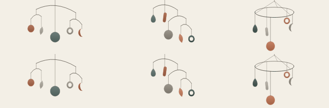
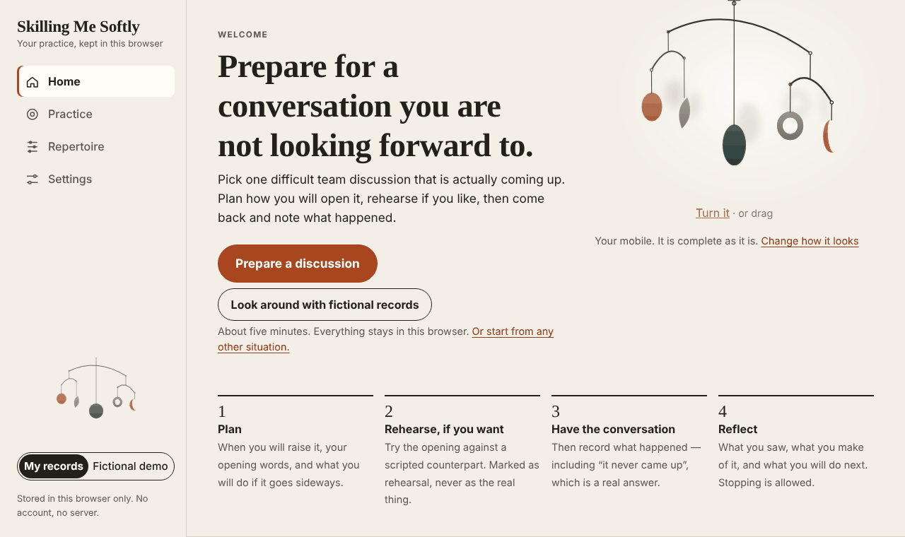
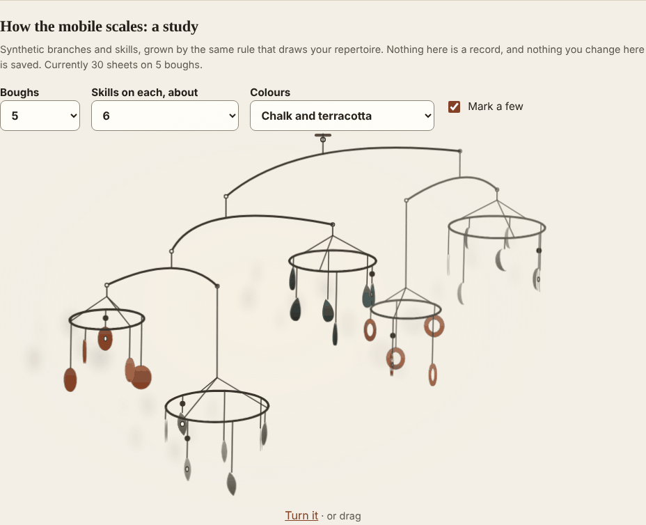
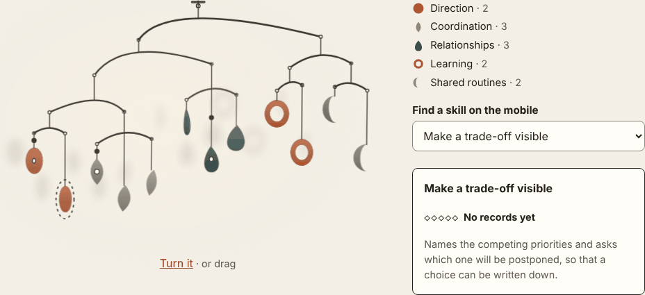

# The mobile: concept

Status: built on `redesign/personal-shell` and described here as built. Sections marked
**open** are questions for the owner, not decisions.

## The idea

A hanging mobile is a small physical argument: many separate things, held in balance, that
answer to the air and to what is hung on them — and to nothing else. That is the stance this
application takes towards a person's development, so the mobile is its one personal object.

It is yours on the first visit and complete as it is. It does not grow, level up, wilt, or
have moods. What changes it is what would change a real one: you turn it, you hang something on
it, the light in the room moves through the day.

## Grammar

| Element | What it is | Rule |
|---|---|---|
| Thread | A line something hangs from | Everything turns freely about its own thread |
| Arm | A bowed wire | Hung off-centre by the lever rule: the heavier side gets the shorter reach |
| Hoop | A horizontal ring on three lines | Carries a fuller group in a ring, at staggered lengths |
| Sheet | A flat piece of painted metal | Six forms: disc, ring, leaf, crescent, bar, drop. Matte, never glossy |
| Bead and inlay | A mark on a sheet and its thread | The only way a sheet shows it carries something. Form, not colour |
| Palette | Wire plus three tones | Four curated sets; tone and form together tell groups apart |

One structure description (`src/mobile/catalogue.ts`), one geometry function
(`src/mobile/scene.ts`), one painter (`src/ui/mobile/Mobile.tsx`). It is drawn as SVG from a real
three-dimensional model — perspective, depth order, shading by how each sheet faces the light,
a shadow on the wall behind — with no WebGL and no added dependency.

## What it answers to

| It answers to | How | Why this is allowed |
|---|---|---|
| Your hand | Drag or the labelled **Turn it** button. A push eases out; sheets lag on their threads and swing back | Direct manipulation |
| Your pointer | Leans slightly towards a mouse | Presence, not data |
| What you hang on it | The bead slides down the thread, that sheet hangs a little lower, the arms above tip towards it | Your choice, one sheet at a time, reversible |
| Something being saved nearby | A small stir | It carries no information about what was saved |
| Arriving on screen | Settles into its pose | |
| The hour | Light from the left in the morning, from the right by evening; the shadow follows. The light on the wall is clear in the morning, warm towards evening, low at night | The local clock, nothing about you |
| Where it is shown | Hero on a first visit, companion on Home, a still mark in the side rail, a small witness when a reflection is saved, a wide map on Repertoire | Same object, different distance |
| Reduced motion | Rests in its authored pose. A drag follows the hand without coasting, the button steps it round, a new memory is simply there | |

## Setting and staging

It hangs somewhere. A fixing at the top, a pool of light on the wall behind it, and its shadow
falling on that wall are what make it an object in a room and not a picture on a page. Small
made-object details carry the same weight: a loop bent into the wire wherever a thread is tied,
a bead where a memory sits.

On a wide Home it hangs from the top edge of the page, so the thread reads as coming from the
ceiling. It is lowered in when it arrives, then left to settle. Its controls stay quiet until
the pointer or the keyboard reaches them.

## What it never answers to

- How much you have recorded, or how well anything went. The picture for an empty record set
  and a full one is identical until you hang something (unit-tested).
- Time away. Nothing fades, droops or resets.
- Anything inferred about you: no mood, no personality, no streak.
- It never rearranges itself, and never asks to be rearranged after a reflection.
- The picture receives geometry, colours and which sheets are marked — never a title or a line
  of anybody's writing (unit-tested).

## Two scales

**The personal mobile** — five sheets, three authored arrangements (Arc, Cascade, Hoop).
A memory is one of your own attempts, chosen by you.

**The grown mobile** — for a skill set. `growMobile` builds one bough per branch and one sheet
per skill, for any size. A branch of up to three skills is a bow; a fuller one is a hoop. Boughs
are gathered by halving, hung by the lever rule, in two tiers so neighbours pass under each
other. Each branch keeps one sheet form and one tone. It frames itself by measuring, and is seen
from further away as it gets larger so the near side does not loom.

On Repertoire it draws the installed skill set (twelve skills in five branches today) with a
legend and a labelled list that does everything a click on a sheet does:

The thirty-skill case is a live study under Settings → Technical details, with synthetic names,
where the number of branches and skills can be changed.

## Accessibility

- The SVG is hidden from assistive technology and described in one sentence.
- Every action on the picture has a labelled HTML twin: memory buttons, the skill select,
  **Turn it**.
- A mark is a bead and an inlay, never colour alone; branches differ in form as well as tone.
- Motion is off under `prefers-reduced-motion`, and the still picture is the same picture.

## Open

1. **Marks on the skill mobile.** A sheet is marked when your records are linked to that skill,
   and the arms tip towards those. That is a statement of where records sit, the same one the
   list makes in words, and marked sheets are not bigger or brighter. It is still the closest
   this comes to "reflecting what you have done", which the brief ruled out for the personal
   mobile. If that is too close, the skill mobile can show the skill set unmarked and leave the
   records to the list.
2. **Thirty real skills.** The generator is tested to 56 sheets, but only twelve real skills
   exist in the content. Names, branch sizes and reading order should be tried with a real set.
3. **Beyond two levels.** Branch → skill is supported. Branch → sub-branch → skill would need the
   generator to take a tree, which is a small change to its input, not to the grammar.
4. **Sound, haptics, device tilt** — not attempted.
5. **Performance.** It redraws in React every frame while on screen. Fine here at thirty sheets;
   not profiled on a slow phone.
