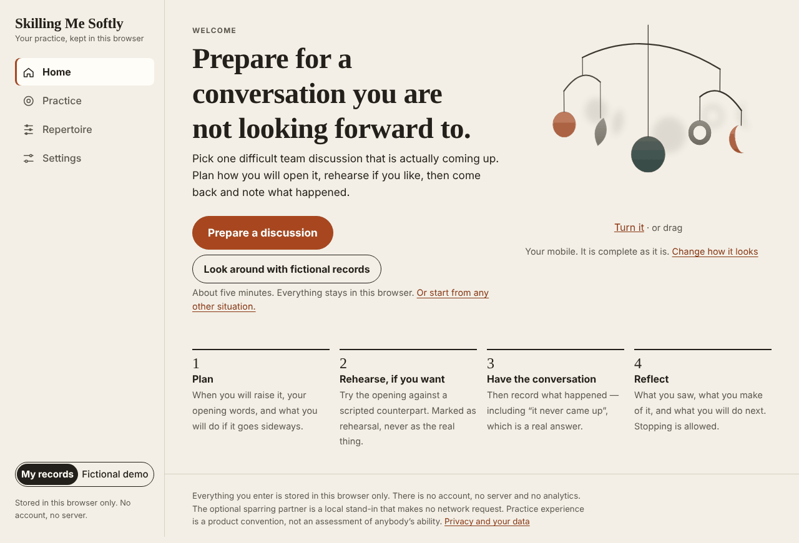
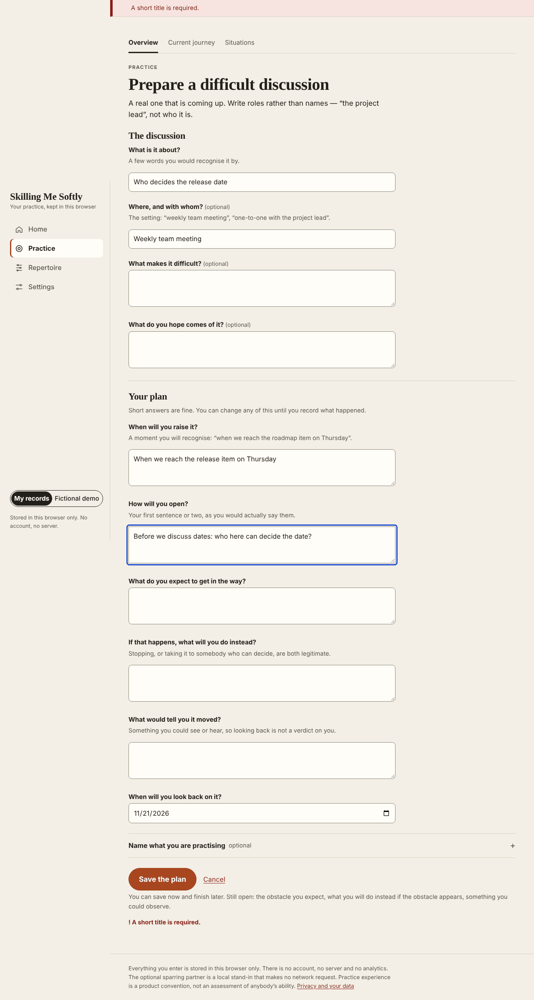
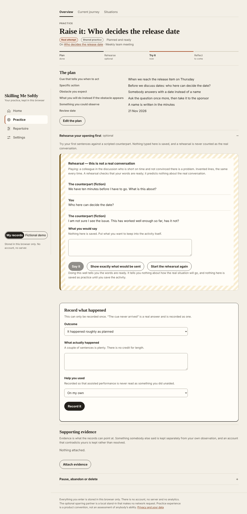
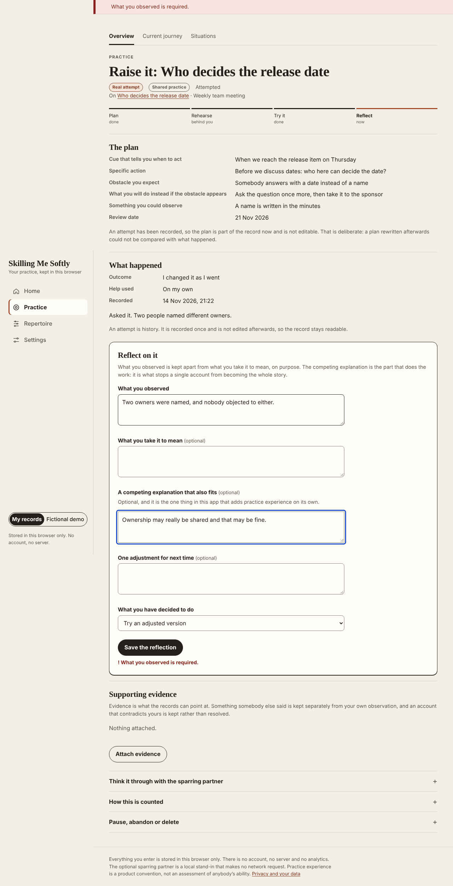
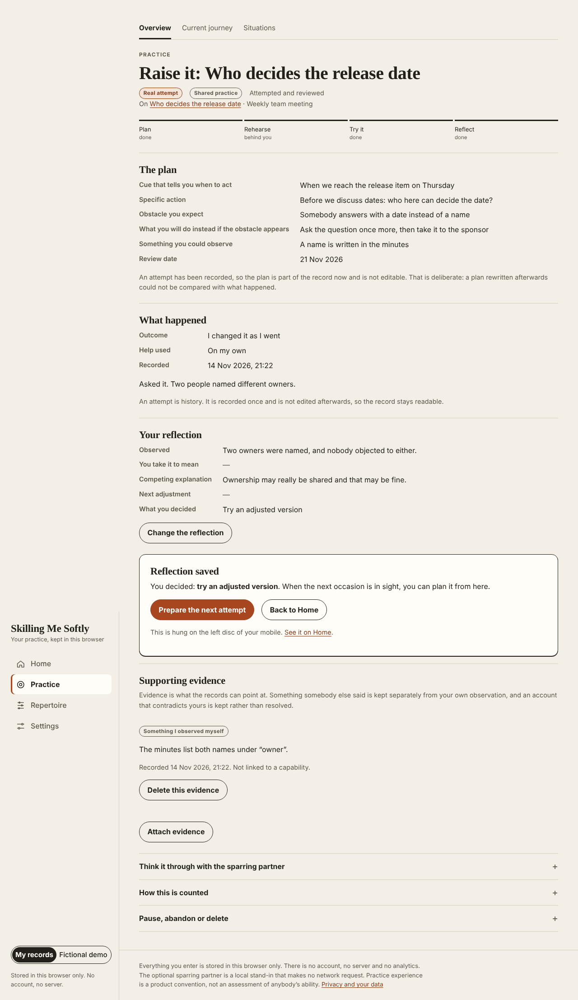
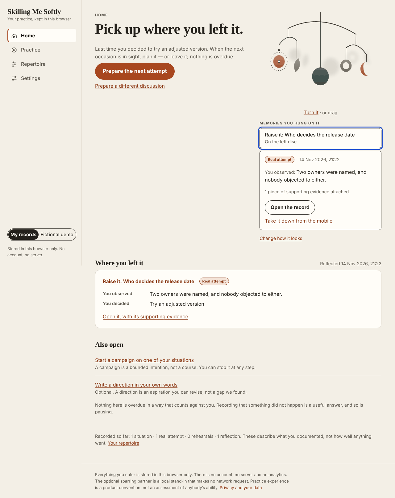
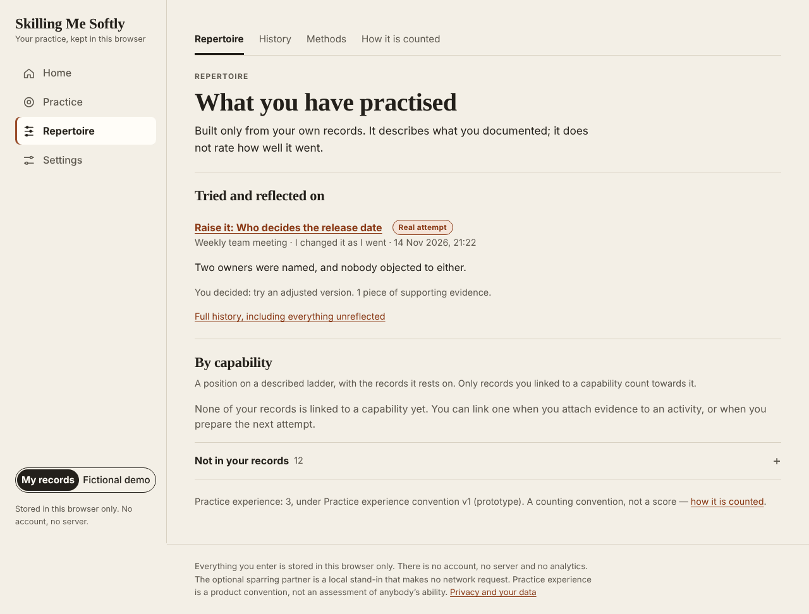
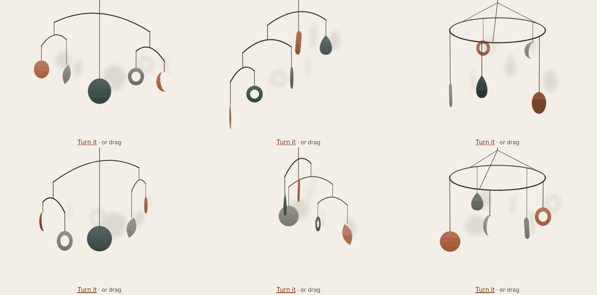

# Redesign: one shell, a short flow, a personal mobile

Branch `redesign/personal-shell`, started from `ccr-cda53478-1fik71` at `d5efbbe`.
Not merged, not deployed. Everything below is what the code on this branch does;
"proposed" is marked as such.

## Run it

```
cd workbench/apps/capability-development/app
npm ci
npm run dev          # http://localhost:5180
npm run verify       # typecheck, lint, unit tests, production build
npm run preview      # serves dist/ on http://localhost:4173
npm run test:browser:redesign   # needs a resolvable Playwright + Chromium
```

## Walkthrough

| Step | Where | What happens |
|---|---|---|
| First visit | `#/` | An invitation to prepare one conversation, the mobile (complete, no records needed), four steps in a line. One primary button.  |
| Plan | `#/prepare` | The discussion, then the plan, saved by one command. An unfinished plan can be saved; the next screen says what is missing.  |
| Optional rehearsal | `#/activity/:id` | A disclosure on the activity. Scripted counterpart, marked as fiction, saves nothing, moves the flow nowhere.  |
| Real attempt | same | "Record what happened", once. "The cue never arrived" stays an ordinary answer. |
| Reflection | same | Observation, meaning, competing explanation, decision.  |
| Reflection saved | same | What you decided, the step that follows from it, and an optional "hang this on your mobile".  |
| Meaningful return | `#/` | Leads with what is waiting, or "pick up where you left it"; shows the latest reflection in your words; the memory is a labelled button that opens the record.  |
| Supporting evidence | activity, Repertoire | Evidence stays on the activity; Repertoire lists what was tried and, per capability, the records it rests on.  |

Before/after pairs at 1280 and 390 px are in `before/` and `after/`
(`<label>-<screen>-<personal|demo>-<width>.png`).

## The mobile in three dimensions



Each arrangement is described as the object it would be — what hangs from what, on how much
thread (`src/mobile/catalogue.ts`). `src/mobile/scene.ts` turns that into a picture: arms and the
hoop turn about their threads, each sheet turns about its own, everything is projected with
perspective from slightly above, sorted back to front, and shaded as matte painted metal under a
light from the upper left, with a soft shadow on the wall behind. The result is still plain SVG:
no WebGL, no new dependency, nothing added to the 820 kB renderer chunk the assemblage needs.

Left alone it drifts slowly. Drag it, or press the labelled **Turn it** button, to turn it; a
push eases out. Under reduced motion it rests in its authored pose, a drag follows the hand
without coasting, and the button steps it round. Balance is authored by eye, not simulated.
The saved format is unchanged: arrangement, palette and memories mean what they meant.

## Where everything went

| Earlier address | Now |
|---|---|
| `#/` | Home (rebuilt) |
| `#/campaign` | Practice → Current journey (same screen, same address) |
| `#/situations`, `/new`, `/:id` | Practice → Situations |
| `#/activity/:id` | Practice (rebuilt as a visible flow) |
| `#/progress` | Repertoire → How it is counted |
| `#/records` | Repertoire → History |
| `#/content` | Repertoire → Methods (also linked from Practice) |
| `#/assemblage` | Settings → Earlier assemblage |
| `#/settings` | Settings (reordered) |
| new: `#/practice`, `#/repertoire`, `#/prepare`, `#/prepare/:situationId` | |

No address was removed, so no redirect was needed. `sectionOf` in `src/ui/router.ts`
is total over routes and is unit-tested.

## Decisions taken without asking

1. **The flow is a door, not a model.** "Prepare a discussion" writes a Situation and a
   real-attempt PracticeActivity through `recordSituation` and `planActivity`, composed in
   one session command. No new record type, no campaign required.
2. **A memory is an attempted activity the person chose.** Not evidence items: a first
   reflection produces no evidence item, and the return state had to work after one loop.
   The memory panel shows the reflection and counts the attached evidence.
3. **A deleted record leaves a visibly empty memory.** Tolerated on read, reported as
   missing, never replaced; the person takes it down. This avoided touching the delete
   cascade.
4. **The mobile is an optional field** (`Appearance.mobile`), same pattern as the
   assemblage: no schema or appearance version bump; older exports read unchanged.
   Until the person changes something, nothing is saved and the default is drawn.
5. **Home places suggestions; the domain still decides them.** Things actually waiting
   lead. General suggestions (write a direction, start a journey) moved to "Also open".
6. **Rehearsal inside the short flow saves no record.** Where an activity has no authored
   rehearsal, a generic fixed script (`src/content/discussion.ts`) is used. A rehearsal that
   should be kept as its own record is still available through a journey.
7. **Sections, not cards.** `.panel` is now a ruled section; only the current step and
   warnings are boxed.
8. **System font stacks.** No font files, no network request; the static build is unchanged.
9. **Diagnostics moved.** Storage revision, versions and the renderer payload are under
   Settings → Technical details; "last saved" left the footer and went there too.
10. **Focus moves to `main` on navigation only**, not on first load, so the skip link is the
    first tab stop.

## Known limitations

- "Campaign" and "journey" both appear: navigation and Practice say *journey*; the journey
  screen itself and some domain-authored suggestion text still say *campaign*.
- Situations, the journey screen, History, Methods, How it is counted and the assemblage
  inherit the shell, tokens and components but were not individually redesigned.
- The plan summary on an activity uses the domain's field labels, not the friendlier
  questions of the Prepare screen.
- Arrangement and colour radios reflect the saved value, so they tick a moment after the
  click rather than on it.
- A memory can only point at an attempted activity, one per shape, five shapes.
- The mobile redraws in React on every animation frame while it is on screen; fine on the machines
  tried here, not profiled on a slow phone. How far you turned it is not remembered between visits.
- Sheets are flat and face-shaded; there is no thread physics, and threads do not swing.
- Dark mode, a second language and the German UI were not attempted.
- No screen-reader pass with real assistive technology; checks were keyboard, roles and
  labels in Chromium only.
- `npm ci` advisories noted in the earlier handoff were not triaged here.
